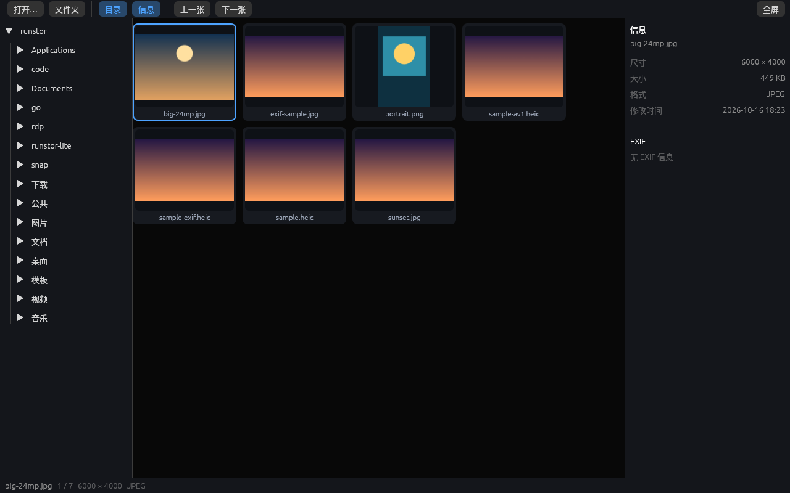
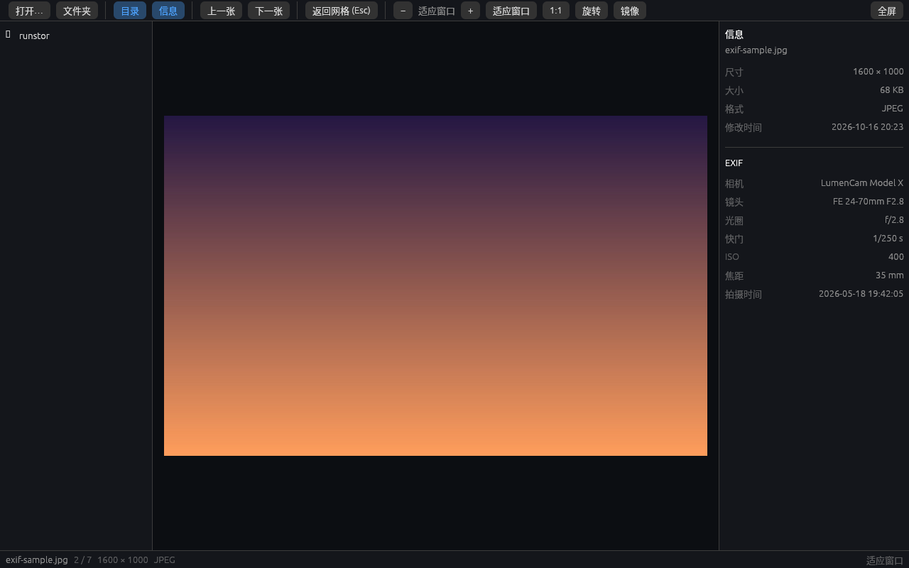
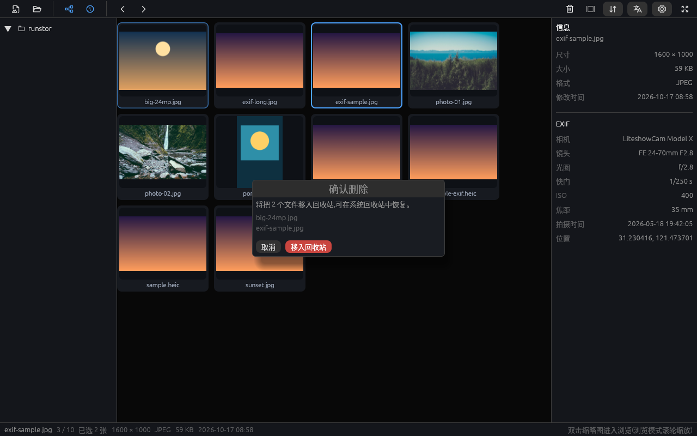
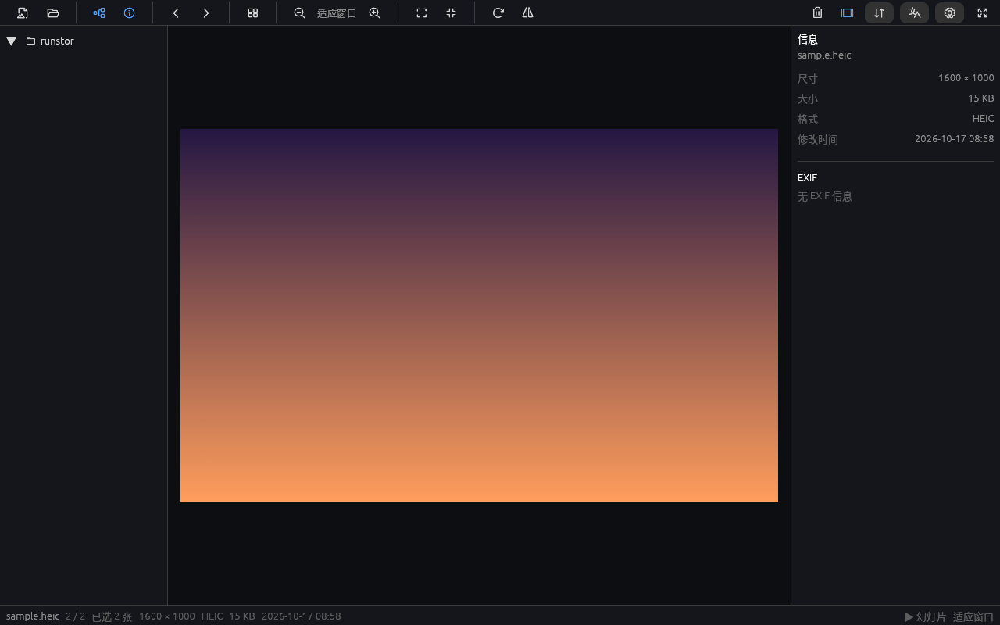
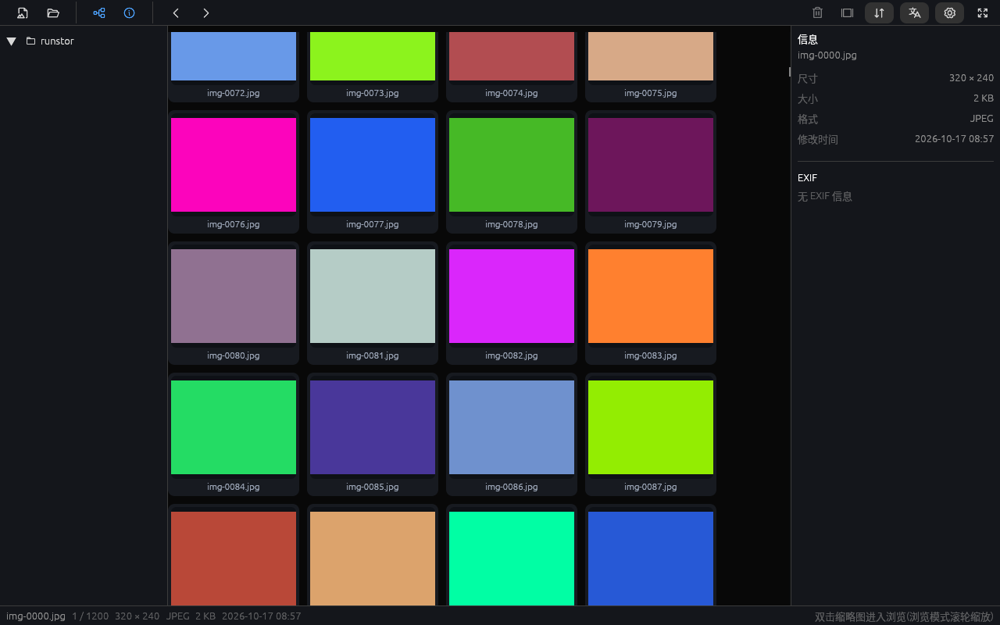
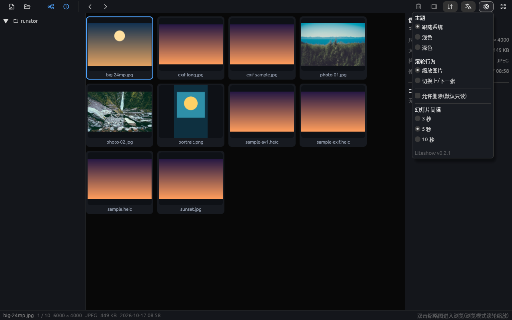
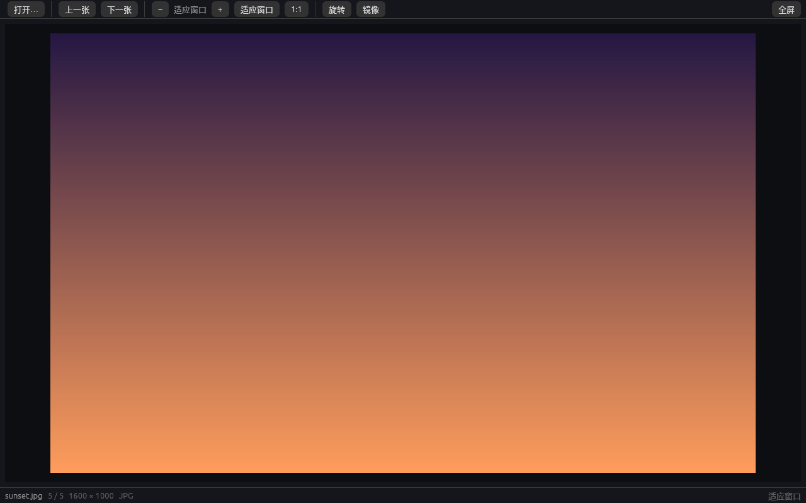
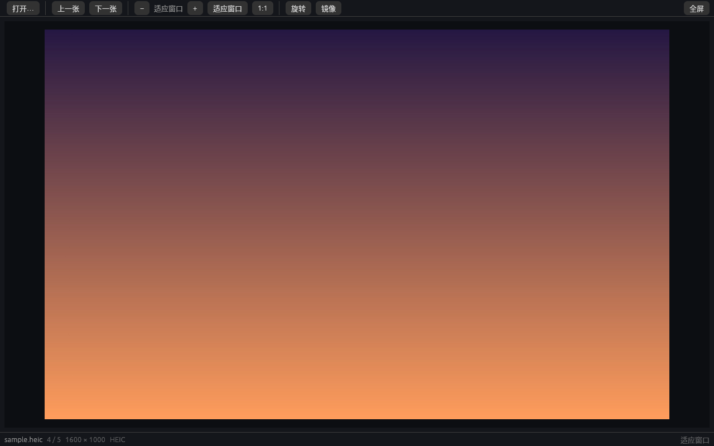
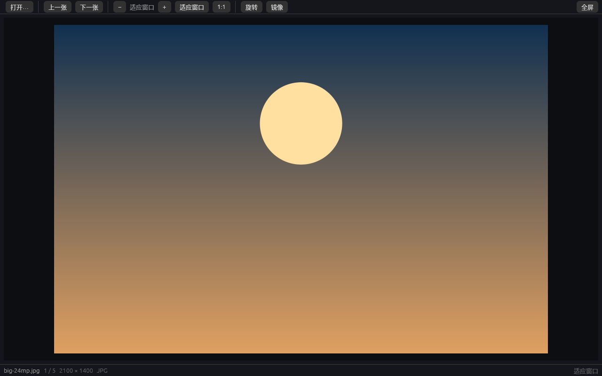

# Liteshow

轻量级跨平台图片查看器(Rust),已到 **M3 打磨**阶段:浏览、EXIF、主题双语、批量删除、幻灯片均已可用。

- 定位:秒开、顺滑、够用 —— 冷启动 < 500 ms,安装包 < 25 MB,内置 12+ 主流图片格式(含 HEIC 与实况照片静帧),中英双语、主题色可换
- 平台:Linux(X11 / Wayland)· Windows · macOS
- 技术栈:eframe(egui)+ wgpu;zune-jpeg / image / fast_image_resize 解码管线;HEIC/AVIF 经运行时加载的 libheif(编译期零 C 依赖)

## 快速开始

```bash
cargo run -p liteshow-app -- <图片文件或文件夹>   # 打开图片 / 浏览目录
cargo test -p liteshow-core                        # 解码 / EXIF / 缩放 / HEIC 单测
```

键位:← → 翻页 · + / − 缩放 · 0 适应窗口 · 1 实际大小 · R 旋转 · F 镜像 · F11 全屏 · Esc 退出全屏 ·
浏览模式 Space 播放/暂停幻灯片 · 网格 Delete 删除(需在设置中开启);也可直接拖拽图片/文件夹到窗口。

> 国内网络:本项目在 `~/.cargo/config.toml` 使用 USTC crates 镜像(见 PLAN 开发环境说明)。

## 版本与发布

- 版本号唯一来源:`Cargo.toml` 的 `[workspace.package]`(当前 **0.2.1**),每次更新用 `packaging/bump-version.sh` 递增第三位(默认 patch)
- 发布流程与 GitHub 上传步骤见 [docs/PUBLISHING.md](docs/PUBLISHING.md);打 `v*` 标签会触发三平台 CI 出包

## 文档

- 📄 [功能清单 + 技术方案 + 里程碑](docs/PLAN.md)

## 部署(用户级本地安装,无需 sudo)

```bash
packaging/install-local.sh                 # 构建(如缺)+ 安装二进制/图标/桌面条目 + 桌面快捷方式
packaging/install-local.sh --set-default   # 可选:把 Liteshow 设为常见图片格式的默认打开程序
packaging/install-local.sh --uninstall     # 卸载以上全部内容
```

安装位置(均为用户级,不碰系统目录):

| 内容 | 路径 |
|---|---|
| 可执行文件 | `~/.local/bin/liteshow` |
| 桌面条目(应用列表 + "打开方式") | `~/.local/share/applications/liteshow.desktop` |
| 图标(256/128/64) | `~/.local/share/icons/hicolor/*/apps/liteshow.png` |
| 桌面快捷方式 | `~/桌面/liteshow.desktop`(自动识别 xdg 桌面目录) |

## 打包(安装包)

| 平台 | 产物 | 构建方式 |
|---|---|---|
| Linux | `liteshow_<ver>_amd64.deb`、`liteshow-<ver>-linux-x86_64.tar.gz`(便携) | `packaging/build-linux.sh` → `dist/linux/` |
| Windows | `Liteshow-<ver>-Setup.exe`(NSIS 安装包)、`liteshow-<ver>-windows-x86_64.zip`(便携) | `packaging/windows/make-package.sh`(可在 Linux 上交叉编译;CI 中为原生构建) |
| macOS | `Liteshow-<ver>-universal.dmg`(Intel + Apple Silicon 通用) | `packaging/macos/make-bundle.sh`(需 macOS 或 CI) |
| 三平台 | 同上 + AppImage | `.github/workflows/release.yml`(推送 `v*` 标签或手动触发) |

Windows 安装包特性:用户级安装(无需管理员)、开始菜单/桌面快捷方式、加入常见图片格式"打开方式"、控制面板卸载项,含中文界面。

> Windows 两个版本:**完整版**(默认,`SHIP_LIBHEIF=1`)随包附带 HEIC/AVIF 解码库,Setup ≈ 17 MB / zip ≈ 24 MB,HEIC 开箱即用;**轻量版**(`SHIP_LIBHEIF=0`)不带 DLL,Setup ≈ 3.4 MB,HEIC 依赖系统或同目录的 libheif.dll。

> **HEIC/AVIF 说明**:安装包默认**不随附** libheif 运行时(保持轻量,Windows 便携包 ≈5MB)。
> 系统已提供 libheif 时(如 Linux 有 `libheif1`、macOS `brew install libheif`、
> Windows 将 `libheif.dll` 及其依赖放入程序目录或 PATH)自动启用;缺失时仅 HEIC/AVIF
> 提示不可用,其余格式不受影响。需随包分发时可 `SHIP_LIBHEIF=1`(Windows)/
> `LITESHOW_BUNDLE_LIBHEIF=1`(macOS)重新打"完整版"。

## 功能(当前版本)

- **目录树浏览**:左侧目录树逐级展开,点击进入即显示该目录全部图片的缩略图网格;**Windows 下为资源管理器式(「此电脑」+ 常用位置 + 盘符),图标直接取自系统(与资源管理器一致)**
- **缩略图网格**:双击缩略图进入浏览模式,**Esc 返回网格**;方向键移动选择,Enter 打开
- **单图浏览**:适应窗口 / 1:1 / 滚轮以光标为锚点缩放 / 拖动平移 / 双击切换 / 旋转与镜像
- **幻灯片**:工具栏 ▶ 或浏览模式 Space 播放;播放**整个目录**或**选中的批量照片**(网格中多选 ≥2 张后启动即只在选中集内循环);间隔 3 / 5 / 10 秒可设
- **批量删除(默认只读)**:缺省不开启删除;设置中勾选「允许删除」后,网格里 Ctrl/Shift 多选、Delete 键或垃圾桶按钮 → **二次确认弹窗** → 移入系统回收站(三平台,可恢复)
- **信息面板**(右侧):文件尺寸、大小、格式、修改时间 + **完整 EXIF**(相机、镜头、光圈、快门、ISO、焦距、拍摄时间、**GPS 坐标**;HEIC/AVIF 亦可读)
- **格式**:JPEG / PNG / GIF / WebP / BMP / TIFF / ICO / TGA / PNM / QOI;HEIC / AVIF(运行时自动探测 libheif)
- **速度**:缩略图磁盘缓存(二次打开秒出)、相邻图预取(翻页零等待)、按显示尺寸解码、头部读尺寸不整图解码;**视口优先**——上万文件的大目录只解析"滚动到哪里就显示哪里"的可见区域(±2 行预读),拖动不卡
- **排序**:名称(自然序,IMG_2 在 IMG_10 前)/ 修改时间 / 创建时间 / 大小 / 类型,升降序一键切换
- **鼠标**:滚轮按"格"缩放(每格 1.15×,光标为锚,平台一致手感)、触控板捏合缩放、左/中键拖动平移、双击适应↔1:1;可在设置中把滚轮改为"翻页"
- **底部状态栏**:文件名、序号、尺寸、格式、**文件大小、修改日期**、当前缩放
- **界面**:Apple 风格细线图标工具栏(悬停提示)、左侧目录树、右侧信息面板(含 EXIF)、**中/英文一键切换**、**深/浅主题(缺省跟随系统,设置中可锁定)**

## 界面











实测(release):24MP JPEG 解码 ~104 ms;24MP 按显示尺寸降采样后纹理仅 2100×1400。

## 进度

- [x] 功能规划与技术方案
- [x] UI 设计稿(见会话内可交互演示)
- [x] M1 骨架:窗口、打开与显示、缩放平移、HEIC 运行时解码
- [x] M2 浏览:目录树、缩略图网格 + 磁盘缓存、视口优先解析、相邻预取、排序
- [x] M3 打磨(部分):深浅主题(随系统)、中英双语、EXIF 信息面板、全屏、批量删除(回收站)、幻灯片
- [ ] M3 余项:动图播放、配置持久化、单实例
- [ ] M4 发布:三平台打包与文件关联

License(计划):MIT OR Apache-2.0
