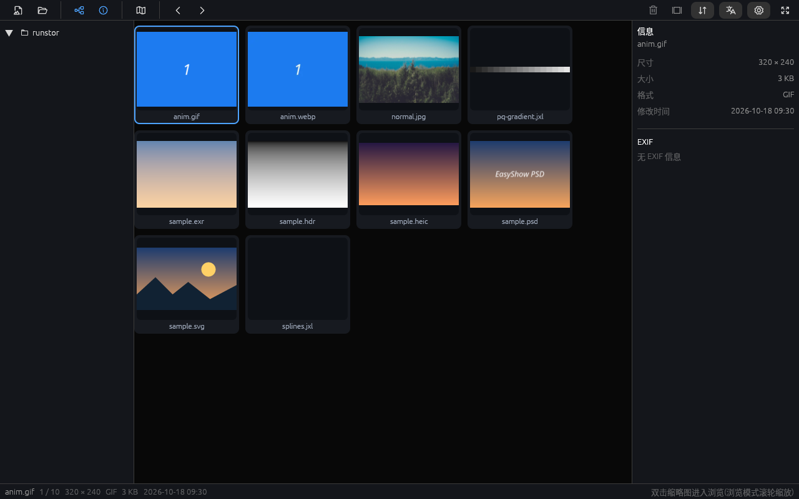
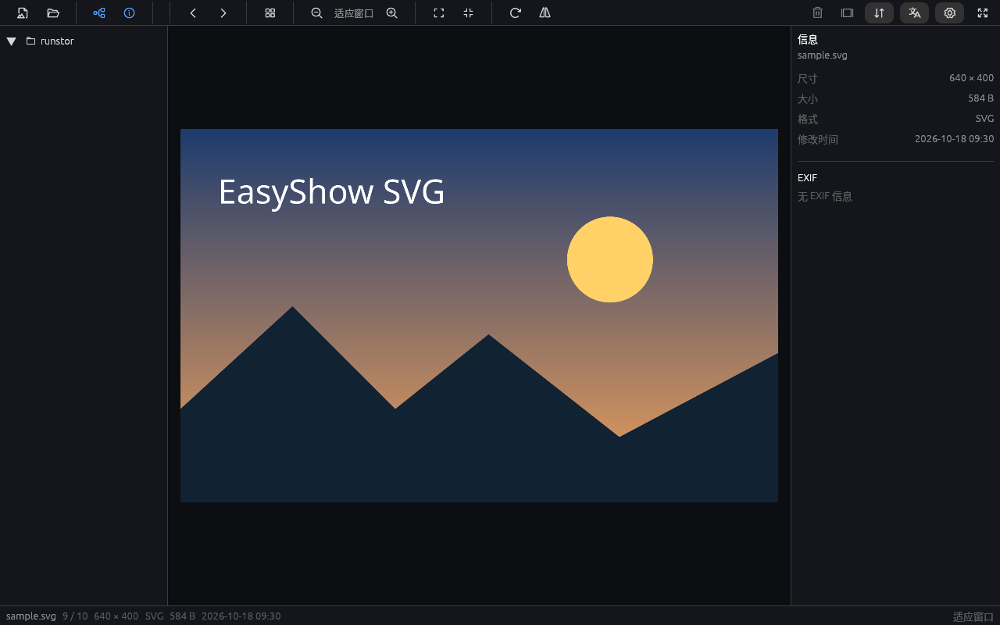
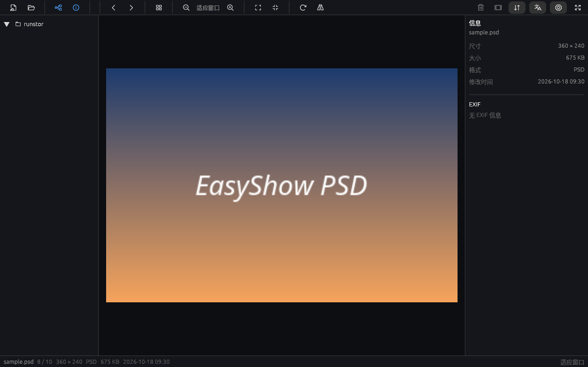
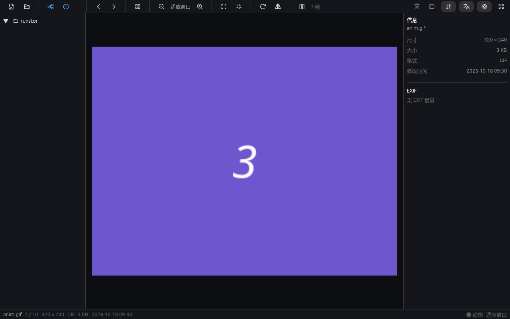
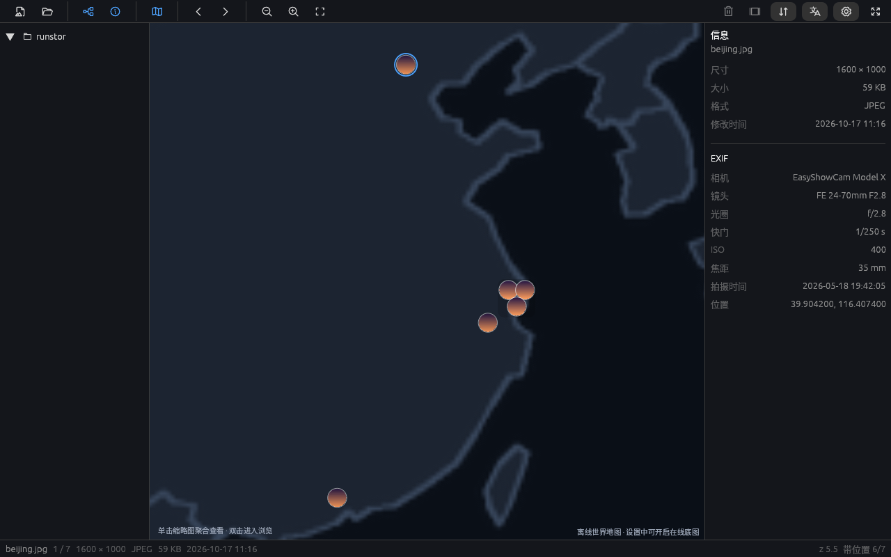
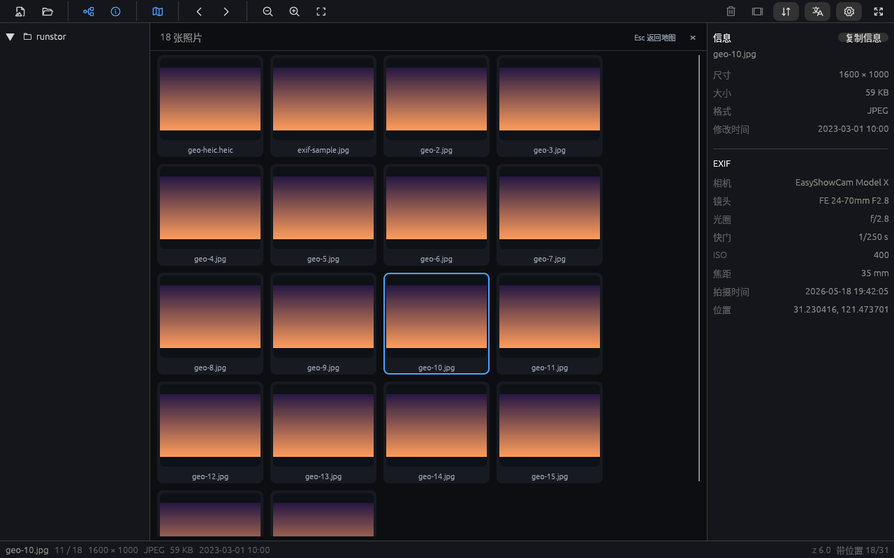
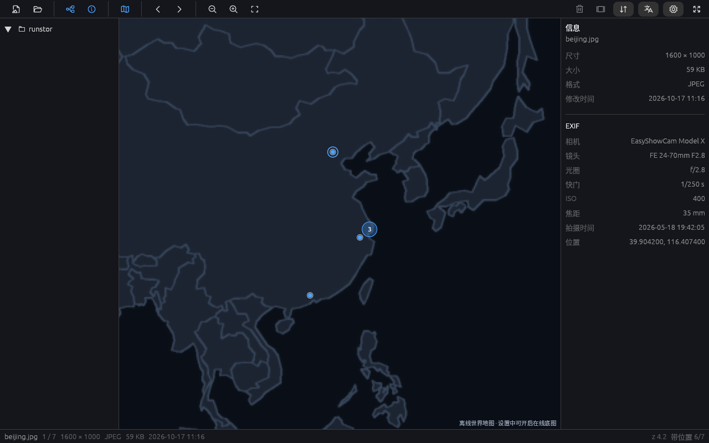
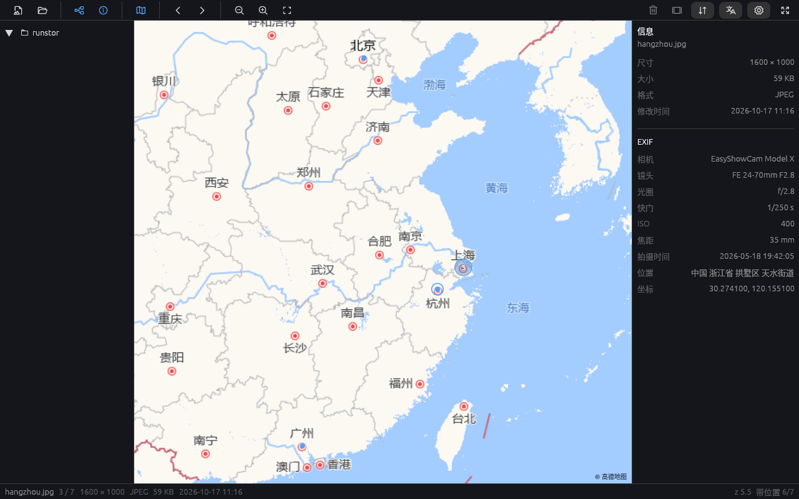
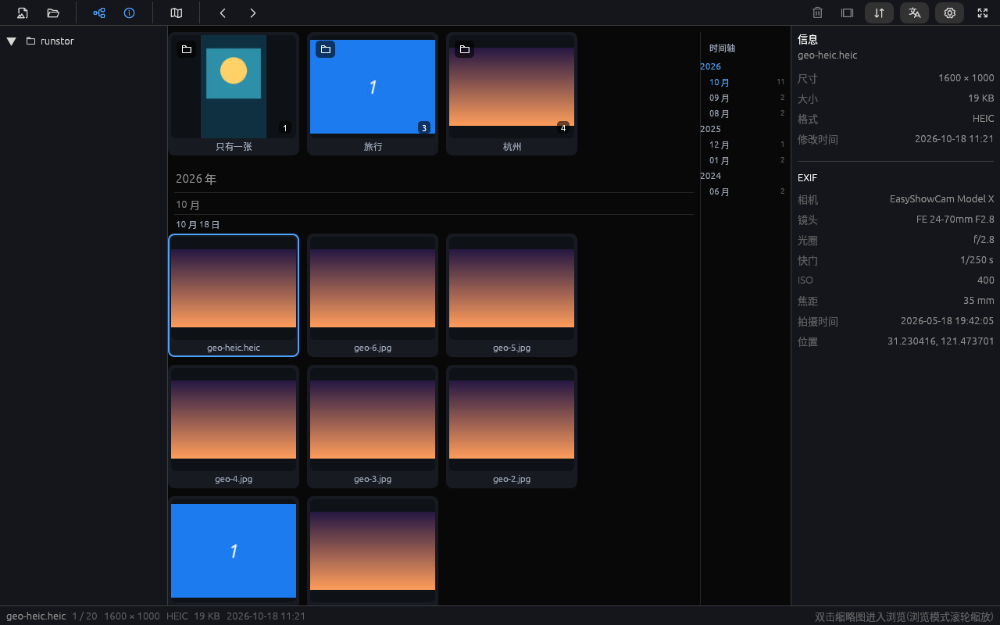
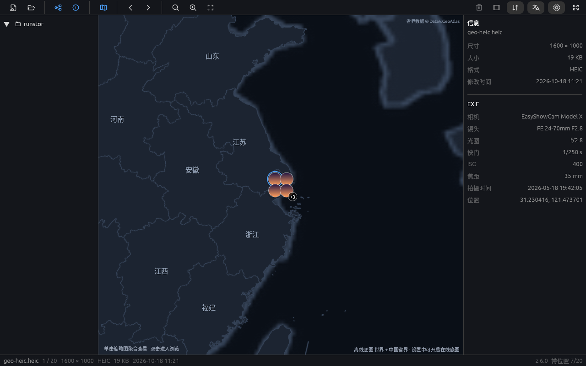

# EasyShow

**English** | [简体中文](README.zh-CN.md)

A lightweight, fast image viewer for the desktop, written in Rust. EasyShow has reached the **M3+** stage: browsing, EXIF/location, maps, animation and extended formats are all usable.

- **Goal:** fast, smooth and sufficient. Cold start < 500 ms, 18+ image formats built in (including HEIC/AVIF, JPEG XL, SVG, PSD, HDR/EXR and GIF/WebP animation), bilingual UI and swappable themes.
- **Release shape:** since 0.2.4 only the **full** build is published (HEIC/AVIF, extended formats and animation). The **lite** build is frozen at 0.2.3 and no longer updated.
- **Platforms:** Linux (X11) · Windows · macOS.
- **Stack:** eframe/egui (glow backend), zune-jpeg / image / fast_image_resize decode pipeline; HEIC/AVIF through a runtime-loaded libheif (no C dependency at build time); JPEG XL/SVG/PSD use pure-Rust decoders.

## Quick start

```bash
cargo run -p easyshow-app -- <image-file-or-folder>   # open an image / browse a folder
cargo test -p easyshow-core                            # decode / EXIF / resize / format tests
```

Keyboard: ← → previous/next · + / − zoom · 0 fit · 1 actual size · R rotate · F flip · F11 fullscreen · Esc exit fullscreen ·
in viewer Space play/pause slideshow · in grid Delete move to trash (enable in Settings) · **M map mode (grid ↔ map)**. Images and folders can also be dragged onto the window.

> Mainland China: this project uses the USTC crates mirror in `~/.cargo/config.toml` (see the development section in the plan).

## State and configuration

EasyShow keeps two small JSON files in the platform config directory:

| File | Contents |
|---|---|
| `config.json` | Online features toggle, AMap key, map tile source (online is **off** by default) |
| `state.json` | Last browsed directory; restored automatically on the next launch |

Directories:

- Windows: `%APPDATA%\EasyShow\`
- macOS: `~/Library/Application Support/easyshow/`
- Linux: `$XDG_CONFIG_HOME/easyshow/` or `~/.config/easyshow/`

If the saved directory no longer exists (removable drive, deleted folder), EasyShow falls back to your home directory.

## Version and releases

- The single source of version truth is `[workspace.package]` in `Cargo.toml` (currently **0.2.7**). Use `packaging/bump-version.sh` to bump the patch version.
- Release process: see [docs/PUBLISHING.md](docs/PUBLISHING.md). Pushing a `v*` tag triggers the GitHub Actions workflow.
- **Current release policy:** Windows full builds only, until the Windows package has been validated. Linux/macOS packaging scripts are kept in the repo but are not published yet. The CI workflow is temporarily Windows-only.

## Documentation

- [Feature list, technical design and milestones](docs/PLAN.md)
- [Publishing guide](docs/PUBLISHING.md)
- [Third-party components and licenses](docs/THIRD-PARTY.md)

## Local install (Linux, user-level, no sudo)

```bash
packaging/install-local.sh                 # full: build (if needed) + install binary/icons/desktop entry
packaging/install-local.sh --lite          # lite build (installed as easyshow-lite, can coexist)
packaging/install-local.sh --set-default   # optional: make EasyShow the default image viewer
packaging/install-local.sh --uninstall     # remove all of the above (--lite --uninstall for lite)
```

Install locations (all user-level):

| Item | Path |
|---|---|
| Executable | `~/.local/bin/easyshow` |
| Desktop entry (app list + "Open with") | `~/.local/share/applications/easyshow.desktop` |
| Icons (256/128/64) | `~/.local/share/icons/hicolor/*/apps/easyshow.png` |
| Desktop shortcut | `~/Desktop/easyshow.desktop` (XDG desktop dir detected) |

## Packaging

The full build (HEIC/AVIF) is packaged as follows. The lite build is frozen and no longer shipped.

| Platform | Artifacts | How |
|---|---|---|
| Windows | `EasyShow-<ver>-Full-Setup.exe` (NSIS installer), `easyshow-<ver>-windows-x86_64-full.zip` (portable) | `packaging/windows/make-package.sh` (cross-compiles on Linux) |
| Linux | `easyshow_<ver>_amd64.deb`, portable tar.gz | `packaging/build-linux.sh` → `dist/linux/` |
| macOS | universal `.dmg` (Intel + Apple Silicon) | `packaging/macos/make-bundle.sh` (macOS or CI) |

Windows installer features: per-user install (no admin), Start-menu/desktop shortcuts, "Open with" registration for common image formats, and an uninstall entry. The portable zip bundles the libheif DLL closure.

> **Build variants**
> - **Full:** HEIC/AVIF via runtime `dlopen` of libheif (no compile-time C dependency), JPEG XL/SVG/PSD/HDR/EXR and GIF/WebP animation. Windows ships the libheif DLL closure; Linux uses the system `libheif1`; macOS bundles libheif inside the app.
> - **Lite (frozen):** no longer updated or published since 0.2.3. Old lite packages are available in the v0.2.3 release.

## Features (current)

- **Folder tree:** expandable directory tree; clicking a folder opens its thumbnail grid. On Windows it mirrors Explorer ("This PC" + quick-access folders + drives with system icons).
- **Thumbnail grid:** double-click a thumbnail to open the viewer, **Esc** returns to the grid; arrow keys move the selection, Enter opens.
- **Subfolder cards:** subfolders containing photos appear as cards at the top of the grid (photo count scanned up to 2 levels deep). The cover is a stable random photo from that folder. **Double-click (or Enter) to enter.**
- **Timeline:** when sorting by time, year/month/day headers and a right-side navigator (year/month + per-month counts) are shown. Click to jump; the current year/month header sticks while scrolling. The default is **file modified time, newest first** (instant); **EXIF capture time** can be selected and is scanned in the background on first use (progress in the status bar).
- **Viewer:** every image opens **fit to window** by default (zoom does not carry over to the next image); 1:1, cursor-anchored wheel zoom, drag pan, double-click fit↔1:1, rotate and mirror.
- **Slideshow:** toolbar ▶ or Space in the viewer; plays the whole folder or the selected batch (multi-select ≥ 2 in the grid); 3/5/10 s intervals.
- **Batch delete (read-only by default):** disabled unless enabled in Settings. With it on, Ctrl/Shift multi-select + Delete or the trash button → confirmation dialog → move to the OS trash (recoverable).
- **Info panel:** dimensions, size, format, modified time and full EXIF (camera, lens, aperture, shutter, ISO, focal length, capture time, GPS; HEIC/AVIF included). **One-click copy** to plain text (EXIF plus place name and coordinates).
- **Location names:** GPS is shown as country–province–city–district–township. AMap is primary (free web-service key in Settings), with OSM Nominatim as fallback (no key). Results are cached by location; offline or with online features off, coordinates are shown.
- **Map mode:** map button or **M** clusters geotagged photos in the current folder. **Clusters display up to 4 photo thumbnails** (1 at low zoom, 4 when zoomed in, +N for the rest). **Clicking a cluster opens a full gallery of that cluster** (virtual scrolling; click to select, double-click to view; Esc steps back to the map at the same position). Single photos can be selected and opened. The built-in **offline basemap** has world outlines plus China province boundaries and province labels; enabling online features overlays AMap/OSM tiles (downloaded per viewport, cached, GCJ-02 aligned for AMap).
- **Online features off by default:** no location or tile requests until enabled in Settings. AMap key and tile source (auto / AMap / OSM) are configurable.
- **Formats:** JPEG / PNG / GIF / WebP (animated) / BMP / TIFF / ICO / TGA / PNM / QOI; **HEIC / AVIF** (runtime libheif), **JPEG XL** (jxl-oxide), **SVG** (resvg, rasterized at display size), **PSD** (flattened composite), **HDR / EXR** (tone-mapped).
- **Animation:** full GIF / WebP playback (background streaming decode with bounded memory); play/pause and frame count in the toolbar.
- **Performance:** disk thumbnail cache (instant on reopen), neighbor prefetch, display-size decoding, header-only dimension reads. **Viewport priority:** huge folders only decode what is visible (±2 rows preloaded). **HEIC thumbnails use the embedded thumbnail** instead of decoding the full image. Map/gallery thumbnails are scheduled together with a per-screen budget and larger clusters first.
- **Sorting:** modified time (default, descending) / **capture time** / name (natural order) / created time / size / type, with one-click direction toggle.
- **Mouse:** wheel zoom in steps (1.15×, cursor anchored), trackpad pinch, left/middle drag pan, double-click fit↔1:1; wheel can be set to page navigation in Settings.
- **Status bar:** file name, index, dimensions, format, file size, modified date, current zoom.
- **UI:** Apple-style thin-line toolbar with tooltips, folder tree, info panel, **English/Chinese toggle**, **light/dark theme** (follows the system by default, can be locked).

## Screenshots















Measured on release builds: 24MP JPEG decode ≈ 104 ms; a 24MP image downsampled to display size yields a 2100×1400 texture.

## Roadmap

- [x] Feature plan and technical design
- [x] M1 foundation: window, open/display, zoom/pan, HEIC runtime decoding
- [x] M2 browsing: folder tree, thumbnail grid + disk cache, viewport-priority decoding, neighbor prefetch, sorting
- [x] M3 polish (partial): light/dark themes, English/Chinese UI, EXIF panel, fullscreen, batch delete to trash, slideshow
- [x] M3+ location and maps: reverse geocoding (AMap/OSM), map mode (offline world map + online tiles, GPS clusters), online toggle and caches
- [x] M3+ extended formats and animation: HDR/EXR, JPEG XL, SVG, PSD, GIF/WebP
- [x] M3++ folders and timeline: subfolder cards, year/month/day timeline, EXIF capture-time sorting, HEIC embedded thumbnails
- [x] M3++ offline province basemap (China), cluster gallery and thumbnail scheduling
- [x] Config persistence: network settings and last-directory restore
- [ ] Remaining M3: single-instance mode
- [ ] M4 release: Windows full builds published; Linux/macOS packaging pending validation

License: MIT OR Apache-2.0.
