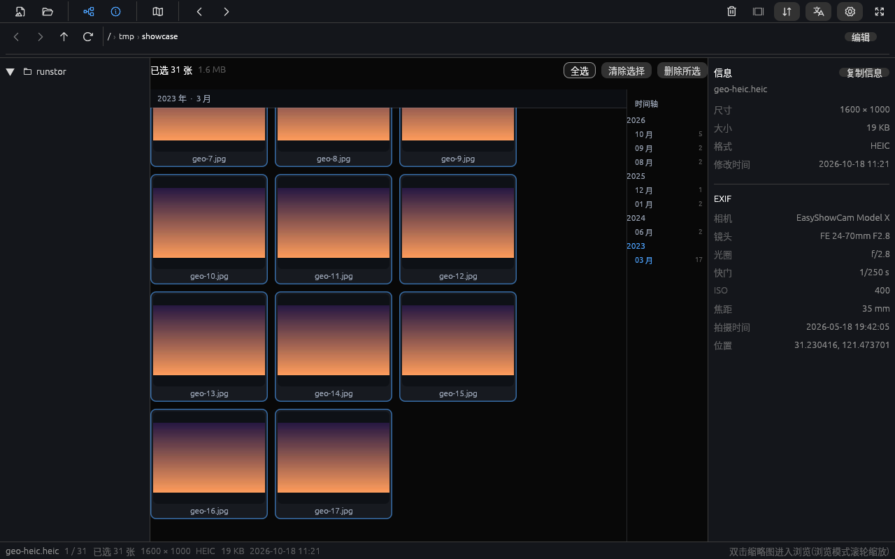
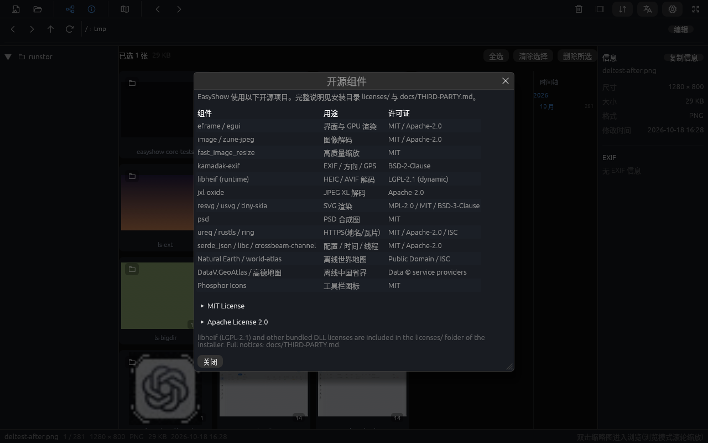

# EasyShow

[English](README.md) | **简体中文**

轻量级跨平台图片查看器(Rust),已到 **M3+** 阶段:浏览、EXIF/位置、地图、动图、扩展格式均已可用。

- 定位:秒开、顺滑、够用 —— 冷启动 < 500 ms,内置 18+ 主流图片格式(含 HEIC/AVIF、JPEG XL、SVG、PSD、HDR/EXR 与 GIF/WebP 动图),中英双语、主题色可换
- **发布形态**:自 0.2.4 起只发布**完整版**(含 HEIC/AVIF、扩展格式与动图);**轻量版 lite 自 0.2.3 起冻结**,不再随新版更新
- 平台:Linux(X11)· Windows · macOS
- 技术栈:eframe(egui)+ glow;zune-jpeg / image / fast_image_resize 解码管线;HEIC/AVIF 经运行时加载的 libheif(编译期零 C 依赖);JPEG XL/SVG/PSD 使用纯 Rust 解码器

## 快速开始

```bash
cargo run -p easyshow-app -- <图片文件或文件夹>   # 打开图片 / 浏览目录
cargo test -p easyshow-core                        # 解码 / EXIF / 缩放 / 扩展格式单测
```

键位:← → 翻页 · + / − 缩放 · 0 适应窗口 · 1 实际大小 · R 旋转 · F 镜像 · F11 全屏 · Esc 退出全屏 ·
浏览模式 Space 播放/暂停幻灯片 · 网格 Delete 删除(需在设置中开启)· **M 地图模式(网格↔地图)**;也可直接拖拽图片/文件夹到窗口。

> 国内网络:本项目在 `~/.cargo/config.toml` 使用 USTC crates 镜像(见 PLAN 开发环境说明)。

## 状态与配置

平台配置目录下有两个小的 JSON 文件:

| 文件 | 内容 |
|---|---|
| `config.json` | 联网开关、高德 Key、地图底图来源(联网默认**关闭**) |
| `state.json` | 上次浏览的目录;下次启动自动恢复 |

目录:

- Windows:`%APPDATA%\EasyShow\`
- macOS:`~/Library/Application Support/easyshow/`
- Linux:`$XDG_CONFIG_HOME/easyshow/` 或 `~/.config/easyshow/`

如果记录的目录已不存在(移动硬盘拔出、目录被删),自动回退到主目录。

## 版本与发布

- 版本号唯一来源:`Cargo.toml` 的 `[workspace.package]`(当前 **0.2.9**),每次更新用 `packaging/bump-version.sh` 递增第三位(默认 patch)
- 发布流程与 GitHub 上传步骤见 [docs/zh-CN/PUBLISHING.md](docs/zh-CN/PUBLISHING.md);打 `v*` 标签触发 GitHub Actions
- **当前发布策略:只发布 Windows 完整版**,待 Windows 包验证通过后再发布 Linux/macOS 包;CI 暂时只构建 Windows

## 文档

- 📄 [功能清单 + 技术方案 + 里程碑](docs/zh-CN/PLAN.md)
- 📄 [发布指南](docs/zh-CN/PUBLISHING.md)
- 📄 [第三方组件与许可](docs/zh-CN/THIRD-PARTY.md)

## 部署(用户级本地安装,无需 sudo)

```bash
packaging/install-local.sh                 # 完整版:构建(如缺)+ 安装二进制/图标/桌面条目 + 桌面快捷方式
packaging/install-local.sh --lite          # 轻量版(安装为 easyshow-lite,与完整版可并存)
packaging/install-local.sh --set-default   # 可选:把 EasyShow 设为常见图片格式的默认打开程序
packaging/install-local.sh --uninstall     # 卸载以上全部内容(--lite --uninstall 卸载轻量版)
```

安装位置(均为用户级,不碰系统目录):

| 内容 | 路径 |
|---|---|
| 可执行文件 | `~/.local/bin/easyshow` |
| 桌面条目(应用列表 + "打开方式") | `~/.local/share/applications/easyshow.desktop` |
| 图标(256/128/64) | `~/.local/share/icons/hicolor/*/apps/easyshow.png` |
| 桌面快捷方式 | `~/桌面/easyshow.desktop`(自动识别 xdg 桌面目录) |

## 打包(安装包)

**完整版 full**(含 HEIC/AVIF)的产物如下;轻量版 lite 已冻结,不再随新版发布:

| 平台 | 产物 | 构建方式 |
|---|---|---|
| Windows | `EasyShow-<ver>-Full-Setup.exe`(NSIS 安装包);`easyshow-<ver>-windows-x86_64-full.zip`(便携) | `packaging/windows/make-package.sh`(可在 Linux 上交叉编译) |
| Linux | `easyshow_<ver>_amd64.deb`;`easyshow-<ver>-linux-x86_64-full.tar.gz`(便携) | `packaging/build-linux.sh` → `dist/linux/` |
| macOS | `EasyShow-<ver>-universal.dmg`(Intel + Apple Silicon 通用) | `packaging/macos/make-bundle.sh`(需 macOS 或 CI) |

Windows 安装包特性:用户级安装(无需管理员)、开始菜单/桌面快捷方式、加入常见图片格式"打开方式"、控制面板卸载项;便携 zip 内含 libheif DLL 闭包。

> **变体说明**
> - **完整版**:含 HEIC/AVIF(运行时 dlopen libheif,编译期零 C 依赖)、JPEG XL/SVG/PSD/HDR/EXR 与 GIF/WebP 动图。Windows 随包附带 libheif DLL 闭包;Linux 经系统 `libheif1`(deb 中 Recommends);macOS 默认把 libheif 打入 App 内。
> - **轻量版 lite(冻结)**:自 0.2.3 起不再更新,也不随新版发布;需要旧 lite 包可从 v0.2.3 的 Release 下载。

## 功能(当前版本)

- **目录树浏览**:左侧目录树逐级展开(资源管理器式细线展开箭头),点击进入即显示该目录全部图片的缩略图网格;**Windows 下为资源管理器式(「此电脑」+ 常用位置 + 盘符),图标直接取自系统**
- **缩略图网格**:双击缩略图进入浏览模式,**Esc 返回网格**;方向键移动选择,Enter 打开
- **子目录卡片**:当前目录下含照片的子目录会以卡片形式排在网格最前(递归 2 层统计),封面从子目录照片中稳定随机选取,显示照片数量;**双击/Enter 进入**
- **地址栏**:工具栏下方资源管理器式地址栏——后退/前进/上一级/刷新、可点击面包屑、可编辑路径(Ctrl+L,Enter 跳转,Esc 取消);快捷键 Alt+←/→/↑、F5。刷新会重扫当前目录并保留选择,地图模式保持原视野
- **多选与批量删除**:Ctrl 点选、Shift 点选/Shift+方向键、Ctrl+A;选择条显示张数与总大小,提供全选/清除/删除。删除需在设置中开启,且**每次删除都二次确认**(数量、总大小、文件名、回收站可恢复说明,默认焦点在取消);批量失败逐项汇总
- **时间轴**:按时间排序时显示加大的年 / 月 / 日分组标题与右侧时间轴导航(年份更醒目)(年/月 + 每月张数),点击跳转,滚动时年月标题吸顶;缺省按**文件修改时间降序**(打开快),可切换为 **EXIF 拍摄时间**(首次需后台扫描,状态栏显示进度)
- **单图浏览**:每张图打开时默认**适应窗口**(缩放不带到下一张)/ 1:1 / 滚轮以光标为锚点缩放 / 拖动平移 / 双击切换 / 旋转与镜像
- **幻灯片**:工具栏 ▶ 或浏览模式 Space 播放**整个目录**或**选中的批量照片**;间隔 3 / 5 / 10 秒可设
- **批量删除(默认只读)**:设置中开启后,网格 Ctrl/Shift 多选、Delete 或垃圾桶按钮 → 二次确认 → 移入系统回收站
- **关于与开源说明**:设置 → 关于 EasyShow,显示版本、GitHub 仓库、联系邮箱 **carllau80@gmail.com**、许可证;「开源组件」窗口列出主要依赖及许可证,并可展开查看 MIT/Apache 全文
- **信息面板**:文件尺寸、大小、格式、修改时间 + **完整 EXIF**(相机、镜头、光圈、快门、ISO、焦距、拍摄时间、**GPS 坐标**;HEIC/AVIF 亦可读);**GPS 坐标可点击跳转到地图对应位置**;**一键复制**为纯文本(含 EXIF、地名与坐标)
- **照片位置**:GPS 显示为「国家-省-市-区县-乡镇」——高德为主(可配 Key)、OSM Nominatim 兜底;结果缓存,关闭联网时回退坐标
- **地图模式**:工具栏地图按钮或 **M** 把当前目录带 GPS 的照片聚合显示——**聚合点最多 4 张缩略图**(低缩放 1 张,放大 4 张,超出 +N),**单击聚合打开查看页,展示该聚合的全部照片**(虚拟滚动;Esc 逐级返回查看页→原地图位置);内置**离线底图(世界轮廓 + 中国省界/省名)**,开启联网后叠加高德/OSM 在线瓦片(GCJ-02 对齐)
- **联网默认关闭**:设置中开启后才请求地名/瓦片;可填高德 Key、选择底图来源
- **格式**:JPEG / PNG / GIF / WebP(含动图)/ BMP / TIFF / ICO / TGA / PNM / QOI;**HEIC / AVIF**、**JPEG XL**、**SVG**、**PSD**、**HDR / EXR**
- **动图**:GIF / WebP 完整播放(后台流式解码,内存有界),工具栏播放/暂停与帧数
- **速度**:缩略图磁盘缓存、相邻图预取、按显示尺寸解码、头部读尺寸;**视口优先**(±2 行预读);**HEIC 用内嵌缩略图**;地图/聚合查看页缩略图统一调度,大聚合优先、限制每屏请求量
- **排序**:修改时间(缺省,降序)/ **拍摄时间** / 名称(自然序)/ 创建时间 / 大小 / 类型,升降序一键切换
- **状态记忆**:启动自动回到上次浏览的目录(`state.json`);联网设置写入 `config.json`
- **鼠标**:滚轮按"格"缩放、触控板捏合、左/中键拖动平移、双击适应↔1:1;可改为"滚轮翻页"
- **状态栏**:文件名、序号、尺寸、格式、文件大小、修改日期、当前缩放
- **界面**:细线图标工具栏、目录树、信息面板、**中/英文一键切换**、**深/浅主题(缺省跟随系统)**

## 界面






实测(release):24MP JPEG 解码 ~104 ms;按显示尺寸降采样后纹理 2100×1400。

## 进度

- [x] 功能规划与技术方案
- [x] UI 设计稿(见会话内可交互演示)
- [x] M1 骨架:窗口、打开与显示、缩放平移、HEIC 运行时解码
- [x] M2 浏览:目录树、缩略图网格 + 磁盘缓存、视口优先解析、相邻预取、排序
- [x] M3 打磨(部分):深浅主题、中英双语、EXIF 信息面板、全屏、批量删除、幻灯片
- [x] M3+ 位置与地图:逆地理编码、地图模式、聚合缩略图、离线中国省界
- [x] M3+ 扩展格式与动图:HDR/EXR、JPEG XL、SVG、PSD、GIF/WebP
- [x] 子目录卡片 / 时间轴 / 拍摄时间排序 / 聚合查看页 / 默认适应窗口 / 复制信息 / 上次目录记忆
- [x] 地址栏导航 / 多选与删除安全 / 关于与开源组件说明
- [ ] M3 余项:单实例
- [ ] M4 发布:Windows 完整版已发布;Linux/macOS 待验证后发布

License:MIT OR Apache-2.0
